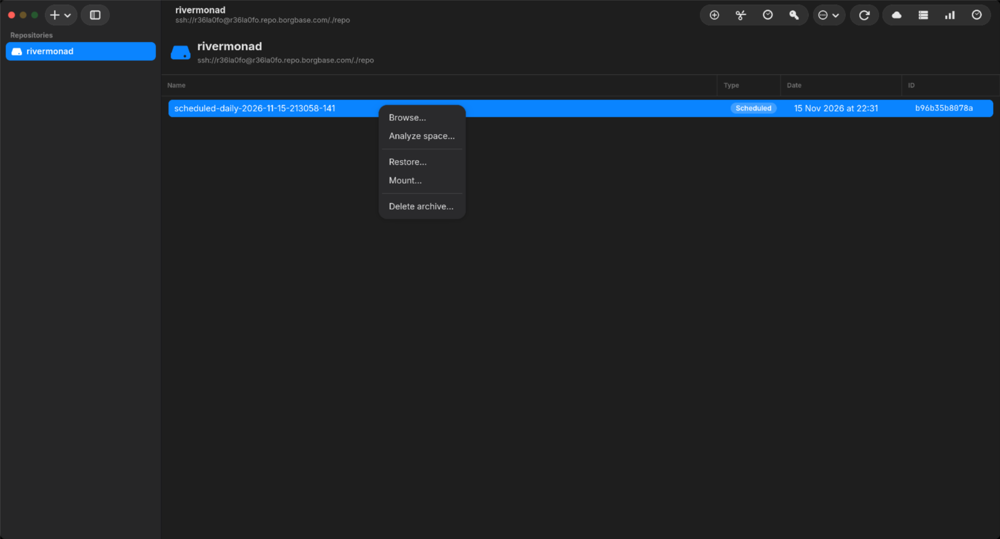
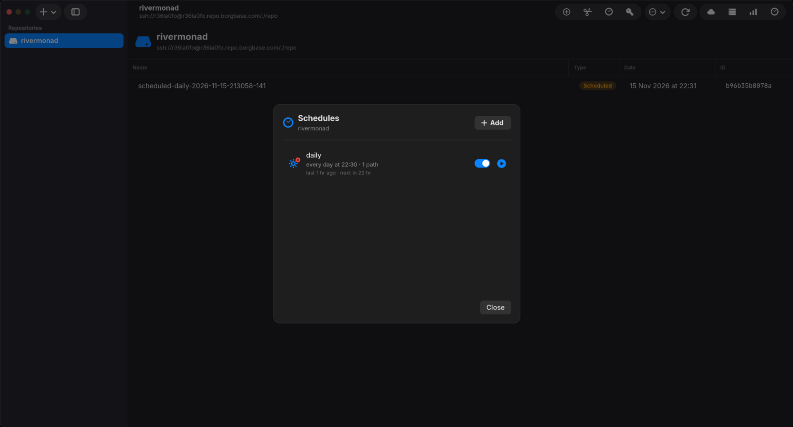
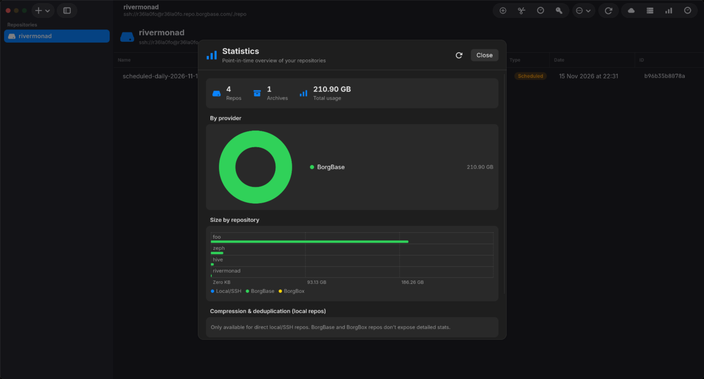

# Luna

A native Linux client for [Borg](https://www.borgbackup.org/) backup repositories — the Linux port of [BorgMac](https://github.com/prietus/borgmac). Rust, GTK4/libadwaita with a macOS-style skin, tray icon, systemd scheduling, and first-class panels for [BorgBase](https://www.borgbase.com/) and self-hosted [BorgBox](https://github.com/prietus/borgbox) servers.



Luna does not reimplement the Borg protocol. It drives the `borg` command line tool as a subprocess, so anything Borg can do with a repository, Luna can too, and your repositories stay fully usable from the terminal or any other client.

## Requirements

- GTK 4.14+ and libadwaita 1.5+ (dark/light follows the system preference).
- Borg 1.x (`borg` in `PATH`).
- A Secret Service keyring (GNOME Keyring, KeePassXC, KWallet…) and `secret-tool` (part of libsecret).
- systemd user session, for schedules.
- `notify-send` (libnotify) for backup notifications; `ssh` / `ssh-keygen` for SSH repositories; FUSE for mounting archives.
- Optional: a StatusNotifierItem tray host (waybar, KDE, GNOME with the AppIndicator extension…) and `gtk4-layer-shell` for the tray popover on wlroots compositors.

## Build and install

```sh
cargo build --release
sudo make install            # PREFIX=/usr/local by default
```

`make install` copies the binary, the desktop entry and the icons. Schedules embed the absolute path of the binary, so install it before creating schedules (or toggle each schedule off and on after moving it).

## Features

Same feature set as BorgMac:

**Repositories**

- Local, SSH, BorgBase and BorgBox repositories side by side in one sidebar.
- Wizards to create a new repository on BorgBase (EU or US), on a BorgBox server, or on local disk / any SSH host, with a choice of encryption mode.
- Passphrases live in the system keyring. Scheduled backups read them non-interactively.
- Pick an existing SSH key or generate a dedicated ed25519 key per repository.

**Backups and archives**

- Manual backups with exclude patterns, progress, and cancellation.
- Any number of schedules per repository, installed as systemd user timers. Retries with backoff, desktop notifications on success or failure, and a "Run now" button.
- Archive browser with full-tree search, previews, and restore of single files or whole folders.
- File history: see every version of a path across all archives.
- Treemap of what takes up space inside an archive.
- Prune (with compact), delete, break-lock, mount, and passphrase change from the UI.

**Tray and status bar**

- Runs in the background behind a tray icon. Its menu shows every schedule with its last result and next run, and lets you start a backup or open the main window. Without a tray host the app simply quits when its window is closed. `luna --background` starts it in the tray without opening the window (for autostart).
- `luna --status-json` prints an overview for a status bar — the stand-in for BorgMac's desktop widget. For waybar:

  ```jsonc
  "custom/borg": {
      "exec": "luna --status-json",
      "return-type": "json",
      "interval": 30,
      "on-click": "luna"
  }
  ```
- `luna --overview-json` prints the same overview as structured JSON (usage by provider and by repository, and every schedule with its last result, next run and live progress), for desktop widgets such as the backups card of [hasklets](https://github.com/prietus/hasklets).

  The module's CSS class is `ok`, `running` or `error`; the tooltip lists usage, running and failed schedules and the next backup.

**BorgBase panel** and **BorgBox panel** — as in BorgMac: quotas, regions, SSH keys, create/rename/edit/delete/import; server stats, sessions, server-side check/prune/compact jobs with live logs, remote archives, append-only, stale-backup alerts, and the automation panel for server-side maintenance schedules.

## Screenshots

| | |
| --- | --- |
|  |  |

## How it works

- Every operation is a `borg` subprocess. Borg's JSON log lines are parsed into readable messages for the UI.
- The passphrase is passed through `BORG_PASSPHRASE` in the child's environment. It is never written to disk or to the command line.
- For SSH repositories with a chosen key, `BORG_RSH` is set to `ssh -i <key> -o IdentitiesOnly=yes`.
- Scheduled backups are systemd user units `luna-backup-<repo>-<schedule>.{service,timer}` in `~/.config/systemd/user`. Each one runs the app binary headless with `--run-backup <repo> <schedule>`, which performs the backup (and the retention prune, if configured) and exits without showing any UI. Timers are `Persistent=true`, so a run missed while the machine was off happens at the next login.

Files on disk:

| Path | Contents |
| --- | --- |
| `~/.local/share/luna/` | Repository list, per-schedule status, status-bar snapshot |
| `~/.cache/luna/` | Cached archive manifests for the browser |
| `~/.local/state/luna/logs/` | One log per schedule |
| `~/.config/systemd/user/luna-backup-*` | Schedules |

Passphrases, API tokens and BorgBox credentials are in the keyring (`secret-tool search service us.priet.Luna`), not in any of these files. `repositories.json` uses the same format as BorgMac's, so the file can be copied over from a Mac (the passphrases have to be re-entered with "Update passphrase").

## Layout

- `src/core` — everything without a UI: models, the `borg` wrapper, keyring, systemd scheduling, the headless backup runner, and the BorgBase and BorgBox API clients.
- `src/ui` — GTK views, one file per sheet or panel; `kit.rs` is the shared widget toolkit and `style.css` the macOS-style skin.

## License

[MIT](LICENSE).
